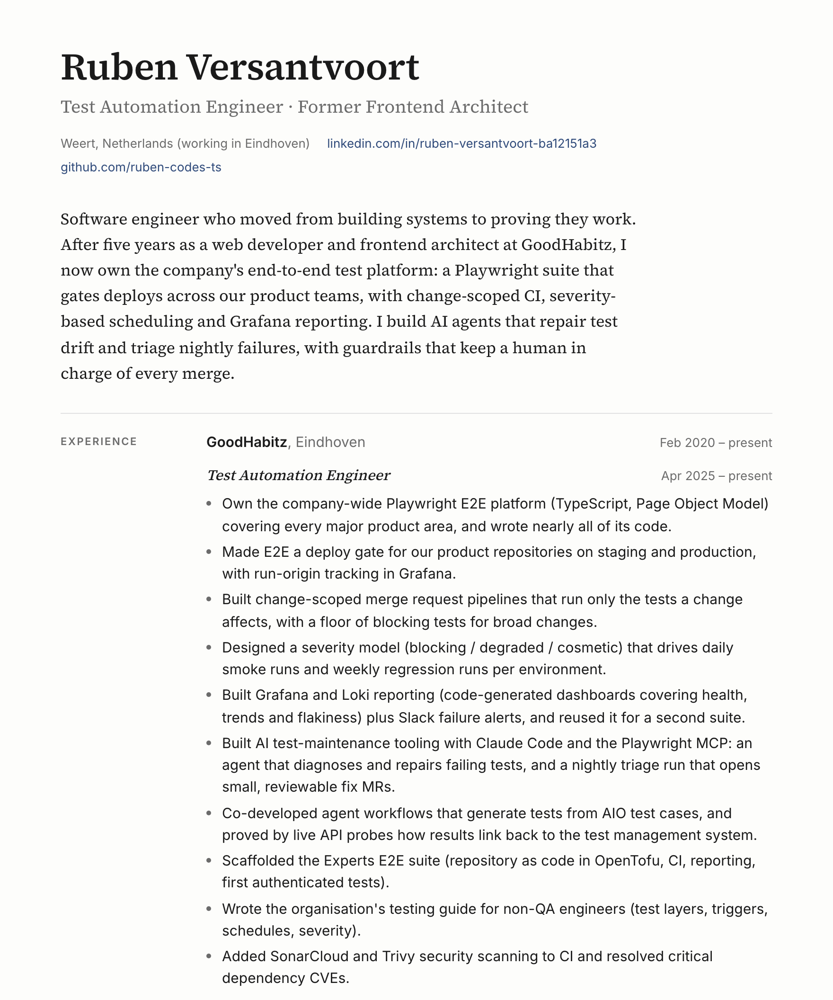

# Ruben Versantvoort · CV

**Read it:** [English (PDF)](public/ruben-versantvoort-cv-en.pdf) · [Nederlands (PDF)](public/ruben-versantvoort-cv-nl.pdf)

[](public/ruben-versantvoort-cv-en.pdf)

## How it works

A test automation engineer's CV should probably be tested and generated, not dragged around in Word. So this one is code:

```
data/cv.en.yaml ─┐
data/cv.nl.yaml ─┴─> Nuxt site (/ and /nl) ──> Playwright prints it ──> A4 PDFs + this preview
```

- **Content** lives in two YAML files, one per language. That's the only place I edit.
- **Layout** is a single Nuxt page with plain CSS. The same stylesheet has a print mode, so the website and the PDF share one design.
- **PDFs** come from `scripts/pdf.mjs`. It serves the built site locally, opens it in headless Chromium and calls `page.pdf()`. The preview image above comes from the same run.

## Build it

```bash
npm install
npx playwright install chromium
npm run generate   # static site in dist/
npm run pdf        # PDFs in public/, preview in docs/
```
